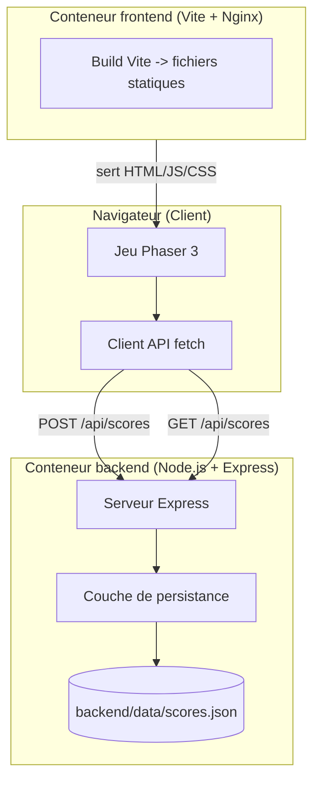
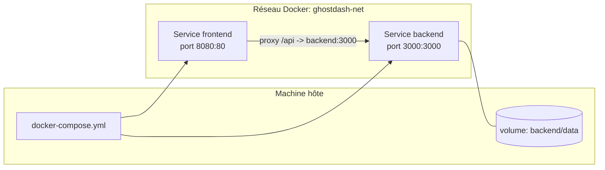
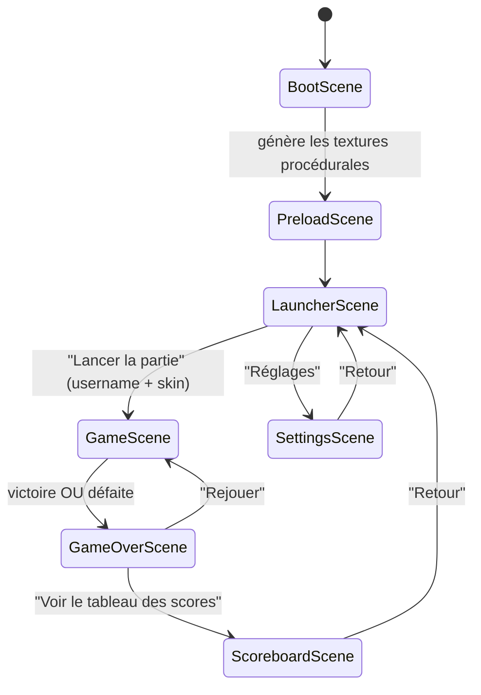

# Document de Conception : Halloween Ghost Dash

## Overview

Halloween Ghost Dash est un jeu de plateforme 2D rétro en pixel art sur le thème d'Halloween. Le joueur incarne un fantôme (blanc ou noir) qui doit collecter 15 bonbons disséminés dans un niveau avant la fin d'un compte à rebours de 45 secondes, tout en évitant ou en détruisant des sorcières patrouilleuses. Le gameplay s'inspire des plateformes de type "Mario" (déplacement latéral, gravité, saut) et ajoute une mécanique de tir à distance (projectiles de bonbons magiques).

L'application est une architecture client-serveur découplée : un **frontend** Phaser 3 (bundler Vite) qui gère tout le rendu, la physique et la logique de jeu, et un **backend** Node.js/Express qui expose une API REST minimale pour la persistance du tableau des scores dans un fichier JSON local. L'ensemble est conteneurisé via Docker et orchestré par `docker-compose.yml`, garantissant une exécution 100 % opérationnelle en local avec une seule commande : `docker compose up --build`.

Priorité de conception : **zéro dépendance d'assets externe**. Tous les graphismes (fantôme, sorcière, bonbons, blocs de sol/plateforme) sont générés de façon procédurale par code via l'API `Graphics`/`generateTexture` de Phaser, ou dérivés de données vectorielles intégrées. Le projet démarre directement sans erreur après `docker compose up`.

---

## Partie 1 — Conception de Haut Niveau (High-Level Design)

## Architecture

> Vue d'architecture globale, topologie Docker et flux des scènes.



### Topologie Docker



**Décisions clés de la topologie :**
- Le frontend et le backend sont deux services distincts sur un réseau Docker partagé (`ghostdash-net`).
- Le frontend expose le port `8080` (host) → `80` (conteneur Nginx servant le build Vite).
- Le backend expose le port `3000` (host) → `3000` (conteneur).
- Les appels `/api/*` depuis le navigateur sont relayés vers le backend. Deux options possibles ; **l'option retenue** est le proxy Nginx côté frontend (`location /api/ { proxy_pass http://backend:3000; }`) afin d'éviter toute configuration CORS et d'utiliser des URL relatives côté client.
- Un volume Docker monte `backend/data` pour que `scores.json` persiste entre les redémarrages des conteneurs.

### Flux des scènes (Scene Flow)



## Components and Interfaces

### Composants principaux

| Composant | Emplacement | Responsabilité |
|-----------|-------------|----------------|
| `BootScene` | frontend | Configuration initiale, mise à l'échelle, chargement des réglages persistés (mute). |
| `PreloadScene` | frontend | Génération procédurale de toutes les textures (fantômes, sorcière, bonbon, blocs, projectile). |
| `LauncherScene` | frontend | Logo, saisie username, choix du skin (blanc/noir), tableau des touches, bouton de lancement. |
| `GameScene` | frontend | Boucle de jeu : physique, collisions, timer, HUD, collecte, combat. |
| `GameOverScene` | frontend | Calcul/affichage du score, boutons Rejouer et Scoreboard, envoi POST du score. |
| `ScoreboardScene` | frontend | Récupération GET et affichage stylisé du Top 10. |
| `SettingsScene` | frontend | Toggle son (mute/unmute) + rappel des raccourcis. |
| `Player` (classe) | frontend | Entité fantôme : physique Mario, invulnérabilité, tir. |
| `Witch` (classe) | frontend | Entité sorcière : patrouille, collision, destruction. |
| `TextureFactory` | frontend | Fonctions utilitaires de dessin procédural → textures. |
| `ApiClient` | frontend | Appels fetch vers `/api/scores`. |
| `SoundManager` | frontend | Gestion globale du son (synthèse Web Audio ou sons générés). |
| `scoresRouter` | backend | Routes Express POST/GET `/api/scores`. |
| `scoreStore` | backend | Couche de persistance JSON (lecture/écriture/tri/Top 10). |

## Data Models

**Score (persisté côté backend) :**
```typescript
/**
 * Enregistrement d'un score persisté dans backend/data/scores.json.
 */
interface ScoreRecord {
  username: string;   // Pseudo saisi au launcher (non vide, max 20 caractères)
  score: number;      // Score calculé (entier >= 0)
  duration: number;   // Durée de la partie en secondes (entier >= 0)
  date: string;       // Horodatage ISO 8601 (généré côté serveur)
}
```

**Configuration de partie (transmise LauncherScene → GameScene) :**
```typescript
/**
 * Données de session passées entre scènes via scene.start(key, data).
 */
interface GameConfig {
  username: string;              // Pseudo du joueur
  skin: "white" | "black";       // Skin du fantôme choisi
}
```

**Résultat de partie (transmis GameScene → GameOverScene) :**
```typescript
/**
 * Résultat d'une partie, utilisé pour l'écran de fin et l'envoi du score.
 */
interface GameResult {
  username: string;
  skin: "white" | "black";
  outcome: "win" | "lose";       // Victoire ou défaite
  candiesCollected: number;      // Bonbons récoltés (0..15)
  candiesRemaining: number;      // 15 - candiesCollected
  secondsRemaining: number;      // Secondes restantes au timer (0..45)
  durationPlayed: number;        // Secondes écoulées (45 - secondsRemaining si victoire)
  score: number;                 // (candiesRemaining * 100) + (secondsRemaining * 50)
}
```

### Contrat d'API REST

| Méthode | Chemin | Corps de requête | Réponse succès | Codes d'erreur |
|---------|--------|------------------|----------------|----------------|
| `POST` | `/api/scores` | `{ username, score, duration }` | `201` `{ success: true, record: ScoreRecord }` | `400` corps invalide |
| `GET` | `/api/scores` | — | `200` `ScoreRecord[]` (Top 10 trié décroissant) | `500` erreur serveur |

**Règles du contrat :**
- `POST /api/scores` valide que `username` est une chaîne non vide (≤ 20 caractères), que `score` et `duration` sont des entiers ≥ 0. Le serveur ajoute `date` (ISO 8601).
- `GET /api/scores` retourne au maximum 10 enregistrements, triés par `score` décroissant, puis par `date` croissante en cas d'égalité.
- Toutes les URL sont relatives (`/api/scores`) côté client ; le proxy Nginx assure le routage vers le backend.

## Testing Strategy

> Stratégie de tests globale (détails de bas niveau dans la section dédiée en Partie 2).

- **Tests unitaires frontend** : logique pure (calcul de score, décrément du timer, règles d'invulnérabilité) extraite dans des fonctions testables (Vitest).
- **Tests unitaires backend** : validation du payload, tri/Top 10, lecture/écriture JSON (Vitest ou node:test), avec un fichier temporaire.
- **Tests basés sur les propriétés (Property-Based)** : via `fast-check` (JS/TS) pour la fonction de calcul de score et le tri du Top 10.
- **Tests d'intégration** : appel réel `POST` puis `GET` sur l'API Express démarrée en mémoire (supertest).

## Error Handling

| Scénario | Condition | Réponse | Récupération |
|----------|-----------|---------|--------------|
| Backend indisponible | fetch échoue (réseau/503) | Afficher un message non bloquant sur l'écran de fin/scoreboard | La partie reste jouable ; le score est conservé en mémoire pour un nouvel essai d'envoi |
| Payload de score invalide | validation `POST` échoue | `400` avec message | Le client logue l'erreur, n'empêche pas de rejouer |
| `scores.json` absent ou corrompu | lecture au démarrage | Le store initialise un tableau vide | Le fichier est recréé à la première écriture |
| Collision frame-perfect multiple | plusieurs contacts simultanés | L'invulnérabilité absorbe les contacts pendant 1,5 s | Un seul cœur perdu par fenêtre d'invulnérabilité |

### Considérations de sécurité

- Pas d'authentification (exigence : username sans mot de passe). Le username est assaini (trim, longueur max, échappement à l'affichage) pour éviter l'injection HTML dans le scoreboard.
- Validation stricte des entrées côté serveur sur `POST /api/scores`.
- Le backend n'écrit que dans son fichier `data/scores.json` ; aucune autre écriture disque.

### Dépendances

**Frontend :** `phaser` (^3.x), `vite` (dev), `vitest` + `fast-check` (dev/test).
**Backend :** `express` (^4.x), `vitest`/`node:test` + `supertest` + `fast-check` (dev/test).
**Infra :** Docker, Docker Compose, image Node.js (build), image Nginx (service frontend statique).

---

## Partie 2 — Conception de Bas Niveau (Low-Level Design)

### Plan d'architecture des fichiers

```
halloween-ghost-dash/
├── docker-compose.yml
├── README.md
├── frontend/
│   ├── Dockerfile
│   ├── nginx.conf              # proxy /api -> backend:3000
│   ├── package.json
│   ├── vite.config.js
│   ├── index.html
│   └── src/
│       ├── main.js             # bootstrap Phaser (config + scènes)
│       ├── config/
│       │   └── gameConstants.js  # constantes de gameplay
│       ├── scenes/
│       │   ├── BootScene.js
│       │   ├── PreloadScene.js
│       │   ├── LauncherScene.js
│       │   ├── GameScene.js
│       │   ├── GameOverScene.js
│       │   ├── ScoreboardScene.js
│       │   └── SettingsScene.js
│       ├── entities/
│       │   ├── Player.js
│       │   └── Witch.js
│       ├── gfx/
│       │   └── TextureFactory.js  # dessin procédural -> textures
│       ├── systems/
│       │   ├── scoring.js         # calcul de score (pur, testable)
│       │   └── SoundManager.js
│       └── services/
│           └── ApiClient.js
├── backend/
│   ├── Dockerfile
│   ├── package.json
│   ├── src/
│   │   ├── server.js           # bootstrap Express
│   │   ├── routes/
│   │   │   └── scores.js       # scoresRouter
│   │   └── store/
│   │       └── scoreStore.js   # persistance JSON
│   └── data/
│       └── scores.json         # créé automatiquement si absent
└── frontend/tests, backend/tests  # tests unitaires/intégration/PBT
```

### Étapes d'implémentation

1. Échafauder la structure des dossiers `/frontend` et `/backend`.
2. Backend : implémenter `scoreStore` (persistance JSON) puis `scoresRouter` et `server.js`.
3. Backend : tests (validation, tri Top 10, intégration POST→GET).
4. Frontend : `main.js`, `gameConstants.js`, `TextureFactory` (textures procédurales).
5. Frontend : `BootScene` + `PreloadScene` (génération des textures).
6. Frontend : `LauncherScene` (UI, choix skin, username).
7. Frontend : entités `Player` et `Witch`, puis `GameScene` (physique, timer, HUD, combat).
8. Frontend : `scoring.js` + tests PBT, `GameOverScene`, `ScoreboardScene`, `SettingsScene`, `SoundManager`, `ApiClient`.
9. Dockerfiles + `nginx.conf` + `docker-compose.yml`.
10. Vérification : `docker compose up --build` démarre sans erreur ; jeu jouable ; scores persistés.

### Constantes de gameplay

```javascript
// frontend/src/config/gameConstants.js
/**
 * Constantes centrales de configuration du gameplay.
 * @readonly
 */
export const GAME = {
  WIDTH: 960,
  HEIGHT: 540,
  GRAVITY_Y: 900,          // gravité verticale (px/s^2)
  PLAYER_SPEED: 220,       // vitesse latérale (px/s)
  PLAYER_JUMP: 480,        // vélocité de saut (px/s)
  PLAYER_HEARTS: 3,        // cœurs de vie initiaux
  INVULN_MS: 1500,         // durée d'invulnérabilité après contact (ms)
  INVULN_BLINK_MS: 120,    // période de clignotement (ms)
  CANDIES_TO_WIN: 15,      // bonbons à collecter pour gagner
  TIMER_SECONDS: 45,       // compte à rebours initial (s)
  PROJECTILE_SPEED: 420,   // vitesse du bonbon magique (px/s)
  PROJECTILE_COOLDOWN_MS: 350, // délai entre deux tirs (ms)
  WITCH_SPEED: 80,         // vitesse de patrouille (px/s)
  SCORE_PER_CANDY: 100,    // points par bonbon restant
  SCORE_PER_SECOND: 50,    // points par seconde restante
};

/**
 * Clés de contrôle clavier.
 * @readonly
 */
export const KEYS = {
  LEFT: ["LEFT", "Q"],
  RIGHT: ["RIGHT", "D"],
  JUMP: ["SPACE", "UP"],
  FIRE: ["F", "E"],
};
```

### Bootstrap Phaser

```javascript
// frontend/src/main.js
/**
 * Point d'entrée : configure le jeu Phaser et enregistre les scènes dans
 * l'ordre du flux (Boot -> Preload -> Launcher -> ...).
 */
import Phaser from "phaser";
import { GAME } from "./config/gameConstants.js";
// ... imports des scènes

/** @type {Phaser.Types.Core.GameConfig} */
const config = {
  type: Phaser.AUTO,
  width: GAME.WIDTH,
  height: GAME.HEIGHT,
  pixelArt: true,                       // rendu pixel art net
  backgroundColor: "#0b0014",
  physics: {
    default: "arcade",
    arcade: { gravity: { y: GAME.GRAVITY_Y }, debug: false },
  },
  scale: { mode: Phaser.Scale.FIT, autoCenter: Phaser.Scale.CENTER_BOTH },
  scene: [BootScene, PreloadScene, LauncherScene, GameScene,
          GameOverScene, ScoreboardScene, SettingsScene],
};

new Phaser.Game(config);
```

### Configuration de la physique (Arcade)

- Moteur : **Arcade Physics** (suffisant et performant pour une plateforme 2D).
- Gravité globale `y = 900`. Le joueur et les sorcières sont des corps dynamiques ; les plateformes/sol sont un `StaticGroup`.
- Le joueur « au sol » est détecté via `body.blocked.down` pour autoriser le saut.
- Les projectiles ignorent la gravité (`body.allowGravity = false`).
- Collisions : `physics.add.collider(player, platforms)` ; `physics.add.overlap(player, candies, ...)` ; `physics.add.overlap(player, witches, ...)` ; `physics.add.overlap(projectiles, witches, ...)`.

### Génération procédurale des textures (TextureFactory)

Approche : utiliser un objet `Phaser.GameObjects.Graphics` pour dessiner chaque sprite, puis appeler `graphics.generateTexture(key, w, h)` dans `PreloadScene`. Le fantôme est décliné en blanc et noir en paramétrant la couleur de remplissage à partir d'une même silhouette vectorielle (dérivée des SVG fournis).

```javascript
// frontend/src/gfx/TextureFactory.js
/**
 * Fabrique de textures procédurales. Chaque méthode dessine une forme via
 * Graphics puis l'enregistre comme texture réutilisable dans le cache Phaser.
 */
export class TextureFactory {
  /**
   * @param {Phaser.Scene} scene Scène active (accès au cache de textures).
   */
  constructor(scene) { this.scene = scene; }

  /**
   * Génère la texture du fantôme pour un skin donné.
   * @param {"white"|"black"} skin Variante de couleur.
   * @param {string} key Clé de texture (ex: "ghost_white").
   * @returns {void}
   */
  makeGhost(skin, key) { /* dessin silhouette + yeux orange, generateTexture */ }

  /**
   * Génère la texture de la sorcière.
   * @param {string} key Clé de texture.
   * @returns {void}
   */
  makeWitch(key) { /* chapeau pointu, robe, balai, generateTexture */ }

  /**
   * Génère la texture d'un bonbon (collectible et projectile).
   * @param {string} key Clé de texture.
   * @returns {void}
   */
  makeCandy(key) { /* bonbon enveloppé, generateTexture */ }

  /**
   * Génère la texture d'un bloc de sol/plateforme d'Halloween.
   * @param {string} key Clé de texture.
   * @param {number} tileSize Taille d'une tuile en px.
   * @returns {void}
   */
  makeTile(key, tileSize) { /* bloc pierre/mousse, generateTexture */ }
}
```

### Scène de préchargement

```javascript
// frontend/src/scenes/PreloadScene.js
/**
 * Génère toutes les textures procédurales avant d'entrer dans le launcher.
 * Aucune ressource réseau n'est chargée : tout est dessiné par code.
 */
export default class PreloadScene extends Phaser.Scene {
  constructor() { super("PreloadScene"); }

  /** Dessine et enregistre les textures, puis passe au LauncherScene. */
  create() {
    const f = new TextureFactory(this);
    f.makeGhost("white", "ghost_white");
    f.makeGhost("black", "ghost_black");
    f.makeWitch("witch");
    f.makeCandy("candy");
    f.makeTile("tile", 32);
    this.scene.start("LauncherScene");
  }
}
```

### Classe Player (entité fantôme)

```javascript
// frontend/src/entities/Player.js
/**
 * Fantôme contrôlé par le joueur. Gère la physique Mario (déplacement,
 * saut, gravité), l'invulnérabilité temporisée et le tir de projectiles.
 * @extends Phaser.Physics.Arcade.Sprite
 */
export default class Player extends Phaser.Physics.Arcade.Sprite {
  /**
   * @param {Phaser.Scene} scene Scène de jeu.
   * @param {number} x Position initiale X.
   * @param {number} y Position initiale Y.
   * @param {"white"|"black"} skin Skin choisi (clé de texture).
   */
  constructor(scene, x, y, skin) { /* add to scene + physics, hearts=3 */ }

  /**
   * Met à jour le mouvement selon l'état des touches.
   * @param {object} input État des touches (left, right, jump).
   * @returns {void}
   */
  handleMovement(input) { /* vx, saut si blocked.down */ }

  /**
   * Tire un projectile de bonbon dans la direction courante si le cooldown
   * est écoulé. N'affecte PAS le compteur des 15 bonbons.
   * @param {Phaser.Physics.Arcade.Group} projectiles Groupe des projectiles.
   * @returns {boolean} true si un tir a eu lieu.
   */
  fire(projectiles) { /* respecte PROJECTILE_COOLDOWN_MS */ }

  /**
   * Applique un dégât : -1 cœur et déclenche l'invulnérabilité clignotante.
   * Ignoré si le joueur est déjà invulnérable.
   * @returns {number} Nombre de cœurs restants.
   */
  takeDamage() { /* if !invuln: hearts--, invuln=1500ms, blink */ }

  /**
   * @returns {boolean} true si le joueur est actuellement invulnérable.
   */
  get isInvulnerable() { /* ... */ }
}
```

### Classe Witch (ennemi)

```javascript
// frontend/src/entities/Witch.js
/**
 * Sorcière ennemie qui patrouille horizontalement sur une plateforme et
 * inverse sa direction aux bords. Peut être détruite par un projectile.
 * @extends Phaser.Physics.Arcade.Sprite
 */
export default class Witch extends Phaser.Physics.Arcade.Sprite {
  /**
   * @param {Phaser.Scene} scene Scène de jeu.
   * @param {number} x Position X.
   * @param {number} y Position Y.
   * @param {number} patrolMin Borne gauche de patrouille (px).
   * @param {number} patrolMax Borne droite de patrouille (px).
   */
  constructor(scene, x, y, patrolMin, patrolMax) { /* ... */ }

  /** Inverse la direction si une borne de patrouille est atteinte. */
  patrol() { /* ... */ }

  /** Détruit la sorcière (effet + removeFromGroup). */
  defeat() { /* ... */ }
}
```

### Scène de jeu (GameScene)

```javascript
// frontend/src/scenes/GameScene.js
/**
 * Boucle de jeu principale : construit le niveau, gère la physique, le
 * timer, le HUD, la collecte de bonbons et le combat contre les sorcières.
 */
export default class GameScene extends Phaser.Scene {
  constructor() { super("GameScene"); }

  /**
   * @param {GameConfig} data username + skin passés par le LauncherScene.
   */
  init(data) { this.cfg = data; }

  /** Construit plateformes, joueur, sorcières, 15 bonbons, HUD et timer. */
  create() { /* ... voir sous-fonctions */ }

  /**
   * Appelée à chaque frame : entrées clavier, patrouilles, HUD.
   * @param {number} time Horodatage courant.
   * @param {number} delta Delta depuis la dernière frame (ms).
   */
  update(time, delta) { /* ... */ }

  /**
   * Collecte un bonbon : incrémente le compteur et vérifie la victoire.
   * @param {Player} player
   * @param {Phaser.GameObjects.GameObject} candy
   * @returns {void}
   */
  onCollectCandy(player, candy) { /* candiesCollected++; if ==15 -> win */ }

  /**
   * Contact joueur/sorcière : applique un dégât (via invulnérabilité).
   * @param {Player} player
   * @param {Witch} witch
   * @returns {void}
   */
  onHitWitch(player, witch) { /* player.takeDamage(); if 0 -> lose */ }

  /**
   * Impact projectile/sorcière : détruit la sorcière et le projectile.
   * @param {Phaser.GameObjects.GameObject} projectile
   * @param {Witch} witch
   * @returns {void}
   */
  onProjectileHit(projectile, witch) { /* witch.defeat(); projectile.destroy() */ }

  /** Décrémente le timer chaque seconde ; déclenche la défaite à 0. */
  tickTimer() { /* secondsRemaining--; HUD; if 0 -> lose */ }

  /**
   * Termine la partie, calcule le résultat et lance GameOverScene.
   * @param {"win"|"lose"} outcome
   * @returns {void}
   */
  endGame(outcome) { /* build GameResult via computeScore -> GameOverScene */ }
}
```

### Logique de score (pure et testable)

```javascript
// frontend/src/systems/scoring.js
/**
 * Calcule le score d'une partie.
 * Formule : (bonbons restants * 100) + (secondes restantes * 50).
 * En cas de victoire, les bonbons restants valent 0.
 * @param {object} p
 * @param {number} p.candiesRemaining Bonbons non collectés (0..15).
 * @param {number} p.secondsRemaining Secondes restantes (0..45).
 * @returns {number} Score entier >= 0.
 */
export function computeScore({ candiesRemaining, secondsRemaining }) {
  return (candiesRemaining * 100) + (secondsRemaining * 50);
}
```

### Scène de fin (GameOverScene)

```javascript
// frontend/src/scenes/GameOverScene.js
/**
 * Affiche l'issue (victoire/défaite) et le score, envoie le score au backend,
 * et propose "Rejouer" et "Voir le tableau des scores".
 */
export default class GameOverScene extends Phaser.Scene {
  constructor() { super("GameOverScene"); }

  /** @param {GameResult} data Résultat de la partie. */
  init(data) { this.result = data; }

  /** Affiche score + boutons ; déclenche l'envoi POST (best-effort). */
  async create() {
    await ApiClient.submitScore({
      username: this.result.username,
      score: this.result.score,
      duration: this.result.durationPlayed,
    }).catch(() => { /* non bloquant : message doux */ });
    // bouton Rejouer -> GameScene(cfg) ; bouton Scoreboard -> ScoreboardScene
  }
}
```

### Scène tableau des scores (ScoreboardScene)

```javascript
// frontend/src/scenes/ScoreboardScene.js
/**
 * Récupère et affiche le Top 10 (Rang, Pseudo, Score, Date) dans un style arcade.
 */
export default class ScoreboardScene extends Phaser.Scene {
  constructor() { super("ScoreboardScene"); }

  /** Récupère GET /api/scores puis affiche le tableau (ou un message si vide). */
  async create() {
    const scores = await ApiClient.fetchTop10().catch(() => []);
    // rendu lignes : index+1, username échappé, score, date localisée
  }
}
```

### Client API (frontend)

```javascript
// frontend/src/services/ApiClient.js
/**
 * Accès à l'API de scores. URL relatives : le proxy Nginx route vers le backend.
 */
export const ApiClient = {
  /**
   * Envoie un score au backend.
   * @param {{username:string, score:number, duration:number}} payload
   * @returns {Promise<ScoreRecord>}
   */
  async submitScore(payload) {
    const res = await fetch("/api/scores", {
      method: "POST",
      headers: { "Content-Type": "application/json" },
      body: JSON.stringify(payload),
    });
    if (!res.ok) throw new Error(`POST /api/scores -> ${res.status}`);
    return (await res.json()).record;
  },

  /**
   * Récupère le Top 10 des scores.
   * @returns {Promise<ScoreRecord[]>}
   */
  async fetchTop10() {
    const res = await fetch("/api/scores");
    if (!res.ok) throw new Error(`GET /api/scores -> ${res.status}`);
    return res.json();
  },
};
```

### Backend — Serveur Express

```javascript
// backend/src/server.js
/**
 * Démarre le serveur Express : JSON middleware + routeur de scores.
 * Écoute sur le port process.env.PORT || 3000.
 */
import express from "express";
import scoresRouter from "./routes/scores.js";

const app = express();
app.use(express.json());
app.use("/api/scores", scoresRouter);

const PORT = process.env.PORT || 3000;
app.listen(PORT, () => console.log(`backend prêt sur :${PORT}`));

export default app; // exporté pour les tests d'intégration (supertest)
```

### Backend — Routeur de scores

```javascript
// backend/src/routes/scores.js
/**
 * Routes REST du tableau des scores.
 * POST /api/scores  : enregistre un score (validation stricte).
 * GET  /api/scores  : renvoie le Top 10 trié par score décroissant.
 */
import { Router } from "express";
import { addScore, getTop10 } from "../store/scoreStore.js";

const router = Router();

/**
 * Valide le payload d'un score.
 * @param {any} body
 * @returns {{ok:true, value:{username:string,score:number,duration:number}}|{ok:false,error:string}}
 */
function validate(body) { /* username non vide <=20, score/duration entiers >=0 */ }

router.post("/", async (req, res) => {
  const v = validate(req.body);
  if (!v.ok) return res.status(400).json({ success: false, error: v.error });
  const record = await addScore(v.value);
  res.status(201).json({ success: true, record });
});

router.get("/", async (_req, res) => {
  try { res.json(await getTop10()); }
  catch { res.status(500).json({ error: "lecture impossible" }); }
});

export default router;
```

### Backend — Couche de persistance

```javascript
// backend/src/store/scoreStore.js
/**
 * Persistance des scores dans backend/data/scores.json.
 * Lecture tolérante (fichier absent/corrompu => tableau vide),
 * écriture atomique, tri Top 10 par score décroissant.
 */
import { readFile, writeFile, mkdir } from "node:fs/promises";
import path from "node:path";

const DATA_DIR = path.resolve("data");
const FILE = path.join(DATA_DIR, "scores.json");

/**
 * Lit tous les enregistrements. Renvoie [] si le fichier est absent/corrompu.
 * @returns {Promise<ScoreRecord[]>}
 */
export async function readAll() { /* try read+JSON.parse ; catch -> [] */ }

/**
 * Ajoute un score (date ISO ajoutée côté serveur) et persiste.
 * @param {{username:string, score:number, duration:number}} input
 * @returns {Promise<ScoreRecord>} L'enregistrement créé.
 */
export async function addScore(input) {
  const all = await readAll();
  const record = { ...input, date: new Date().toISOString() };
  all.push(record);
  await mkdir(DATA_DIR, { recursive: true });
  await writeFile(FILE, JSON.stringify(all, null, 2), "utf8");
  return record;
}

/**
 * Renvoie les 10 meilleurs scores (tri décroissant par score,
 * puis date croissante en cas d'égalité).
 * @returns {Promise<ScoreRecord[]>}
 */
export async function getTop10() {
  const all = await readAll();
  return all
    .sort((a, b) => b.score - a.score || a.date.localeCompare(b.date))
    .slice(0, 10);
}
```

### Configuration Docker

**frontend/Dockerfile** (build multi-étapes : build Vite puis service Nginx) :
```dockerfile
# Étape build
FROM node:20-alpine AS build
WORKDIR /app
COPY package*.json ./
RUN npm ci
COPY . .
RUN npm run build

# Étape service statique
FROM nginx:alpine
COPY nginx.conf /etc/nginx/conf.d/default.conf
COPY --from=build /app/dist /usr/share/nginx/html
EXPOSE 80
```

**frontend/nginx.conf** (sert le build + proxy API, évite CORS) :
```nginx
server {
  listen 80;
  root /usr/share/nginx/html;
  index index.html;

  location / { try_files $uri $uri/ /index.html; }

  location /api/ {
    proxy_pass http://backend:3000;
    proxy_set_header Host $host;
  }
}
```

**backend/Dockerfile** :
```dockerfile
FROM node:20-alpine
WORKDIR /app
COPY package*.json ./
RUN npm ci --omit=dev
COPY . .
EXPOSE 3000
CMD ["node", "src/server.js"]
```

**docker-compose.yml** (racine) :
```yaml
services:
  backend:
    build: ./backend
    container_name: ghostdash-backend
    ports:
      - "3000:3000"
    volumes:
      - ./backend/data:/app/data   # persistance de scores.json
    networks:
      - ghostdash-net

  frontend:
    build: ./frontend
    container_name: ghostdash-frontend
    ports:
      - "8080:80"
    depends_on:
      - backend
    networks:
      - ghostdash-net

networks:
  ghostdash-net:
    driver: bridge
```

**Garanties « out-of-the-box » :**
- `docker compose up --build` construit les deux images et démarre les services.
- Le jeu est accessible sur `http://localhost:8080`.
- Les appels `/api/*` sont relayés par Nginx vers `backend:3000` (pas de CORS, URL relatives).
- `backend/data` est monté en volume ; `scoreStore` crée `scores.json` à la première écriture s'il est absent, et tolère un fichier corrompu.
- Aucune ressource graphique externe : toutes les textures sont générées par code au démarrage.

### Spécifications formelles des fonctions clés

**`computeScore` :**
- Préconditions : `candiesRemaining ∈ [0,15]`, `secondsRemaining ∈ [0,45]`, entiers.
- Postconditions : retour entier `≥ 0` ; monotone croissant en `candiesRemaining` et `secondsRemaining`.

**`Player.takeDamage` :**
- Précondition : joueur initialisé avec `hearts ≥ 0`.
- Postconditions : si `isInvulnerable` → aucun changement ; sinon `hearts' = hearts - 1`, invulnérabilité active pendant `INVULN_MS`.

**`getTop10` :**
- Postconditions : longueur `≤ 10` ; trié de façon décroissante par `score` ; pour tout i<j, `result[i].score ≥ result[j].score`.

**`addScore` :**
- Précondition : payload validé.
- Postconditions : fichier contient l'enregistrement avec `date` ISO ; retour = enregistrement créé.

## Correctness Properties

### Property 1: Formule de score déterministe
Pour tout `cr ∈ [0,15]` et `sr ∈ [0,45]` :
`computeScore({candiesRemaining: cr, secondsRemaining: sr}) === cr*100 + sr*50`.

**Validates: Requirements 10.1, 10.2**

### Property 2: Monotonie du score
Pour tout `cr1 ≤ cr2` et `sr` fixe : `computeScore(cr1, sr) ≤ computeScore(cr2, sr)`. De même en `secondsRemaining`.

**Validates: Requirements 10.1**

### Property 3: Top 10 trié et borné
Pour toute liste de scores, `getTop10` renvoie au plus 10 éléments et, pour tout `i < j`, `result[i].score ≥ result[j].score`.

**Validates: Requirements 16.1, 16.2**

### Property 4: L'invulnérabilité absorbe les contacts
Deux appels à `takeDamage()` séparés de moins de `INVULN_MS` ne retirent qu'un seul cœur.

**Validates: Requirements 7.2, 7.3**

### Property 5: Le tir ne décrémente pas le compteur de victoire
Quel que soit le nombre d'appels à `fire()`, `candiesCollected` reste inchangé par le tir.

**Validates: Requirements 9.5**

### Property 6: Persistance round-trip
Pour tout score valide `s`, après `addScore(s)` l'appel `readAll()` contient `s` avec une `date` au format ISO 8601.

**Validates: Requirements 15.1, 15.2, 15.4**

### Stratégie de tests (Low-Level)

- **Unitaires frontend (Vitest)** : `computeScore` (cas limites 0/15, 0/45) ; logique d'invulnérabilité (mock horloge).
- **PBT frontend (fast-check)** : propriétés 1, 2 sur `computeScore`.
- **Unitaires backend (Vitest/node:test)** : `validate` (payloads valides/invalides) ; `getTop10` (tri, borne 10, égalités).
- **PBT backend (fast-check)** : propriété 3 sur `getTop10` ; propriété 6 round-trip sur un fichier temporaire.
- **Intégration backend (supertest)** : `POST /api/scores` (201) puis `GET /api/scores` reflète l'ajout trié ; `POST` invalide → `400`.
